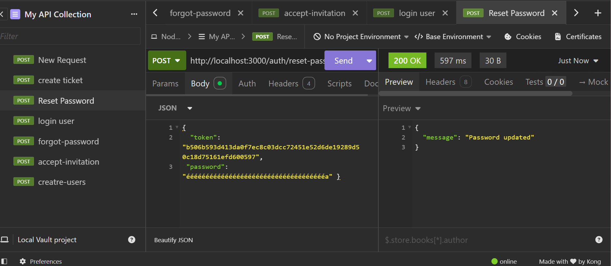
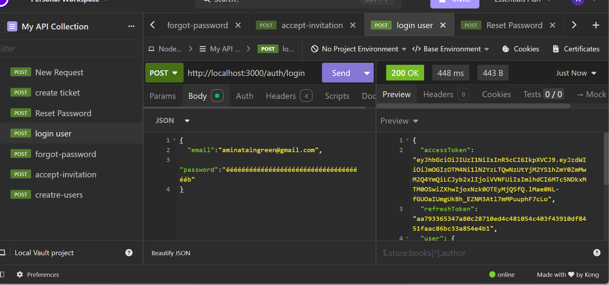
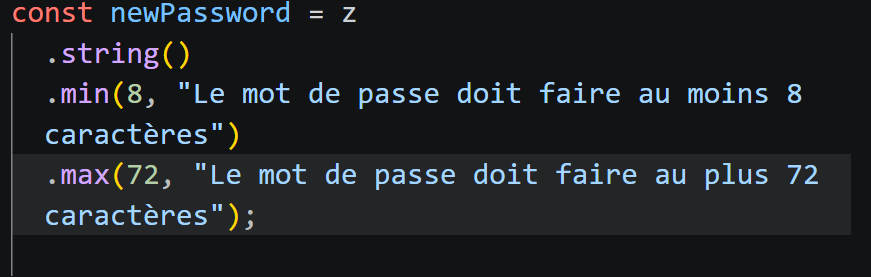
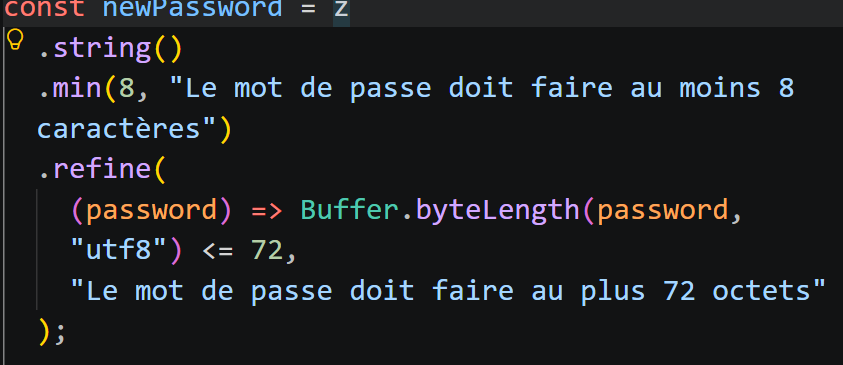
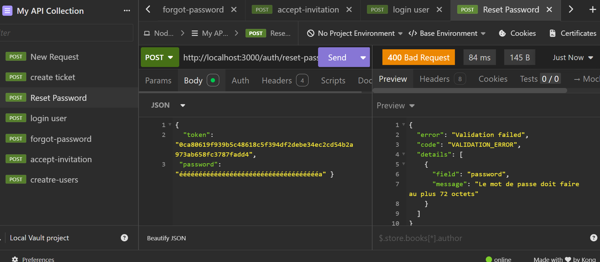
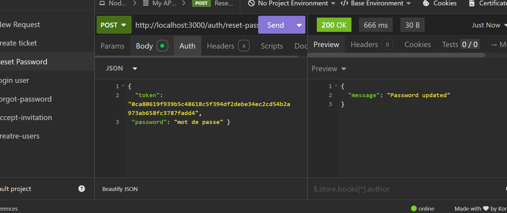

# NOM : Lecture des mots de passe par bcrypt

Les mots de passe de plus de 72 octets UTF-8 permettent de se connecter meme si le mot de passe de connection n'est aps identique a celle de la base de donnees. 

# DESCRIPTION

Le 'new password', lors du reset password, demande au maximum 72 caracteres pour le nouveau mot de passe donc temps que le nouveau mot de passe ne depasse pas 72 caracteres les donnees sont acceptees et enregistrer dans la base de donnees

Cependant, lors de la connection les verifications s'arrete que au 72eme octets donc tout ce qui va au dela de ce nombre d'octets n'est pas verifier lors de la comparaison. 

# LOCALISATION

Cette vulnerabilite ce trouve dans le fichier : 
  src/schemas/auth.schema.ts:10  
et concerne les routes :
 POST /auth/reset-password
 POST /auth/login

# CRITERE : Elevée 

# SCENARIO d'EXPLOITATION

Pour exploiter cette vulnérabilité, un attaquant doit disposer d'un moyen autorisé de réinitialiser le mot de passe du compte ciblé, par exemple un token de réinitialisation valide.

L'attaquant accède à la fonctionnalité POST /auth/reset-password avec un token de réinitialisation valide.

Il soumet un nouveau mot de passe composé de caractères dont la taille UTF-8 dépasse 72 octets, tout en restant inférieur ou égal à 72 caractères.

En raison de la validation .max(72), le mot de passe est accepté, hashé par bcrypt et enregistré en base de données.

L'attaquant tente ensuite de se connecter via POST /auth/login en utilisant une chaîne différente, mais partageant les mêmes 72 premiers octets que le mot de passe enregistré.

bcrypt ignore les octets supplémentaires et la comparaison peut réussir malgré la différence entre les deux chaînes.

# PREUVE d'EXPLOITATION

Nous allons prouver l'existance de la vulnerabilite avec deux mots de passe distincts

 Nouveau mot de passe : "é" x (36) + "a"
 Mot de passe de connexion : "é" x (36) + "b"

 "é" x 36 = 72 octets 

donc les mots de passe de tests font 73 octets UTF-8 
Leurs 72 premiers octets sont identiques. Seul le 73e octet diffère.

Résultat attendu avant correction :
La validation Zod accepte le mot de passe initial, car il contient moins de 72 caractères. bcrypt peut ensuite accepter les deux chaînes lors de la comparaison.

## Nouveau mot de passe 

## Mot de passe de connexion

# IMPACT

Si la vulnerabilite reste inchanger, il sera facile d'utilise le brute force pour se loger aux comptes. L'attaquant n'aura pas besoin de trouver tous les caracteres pour pouvoir hacker un compte.

Utilisateurs : Perdre l'usage de son compte, porter coupable des actions de l'attaquant 
Entreprise : Perte de credibilite, perte de donnees
Donnees : facilement recceuillient, peuvent etre modifier 

# CORRECTION 

Avant 

Apres 

Cette correction garantit que seuls les mots de passe dont la taille UTF-8 ne dépasse pas 72 octets sont acceptés.

# RETEST

On reessaye de reset le mot de passe avec 73 octets

Puis lorsqu'on essaye avec un mots de passe de moins de 73 octets 

Finalement, avec la correction du code, on se rend compte que la vulnerabilite est corrige et ce n'est plus possible d'enregistrer un mot de passe qui depasse les 72 octets UTF-8. 

 