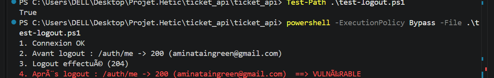
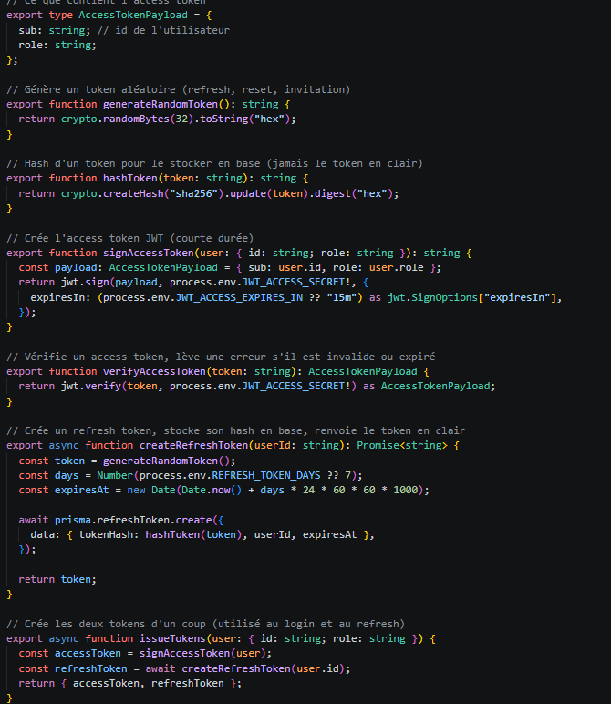
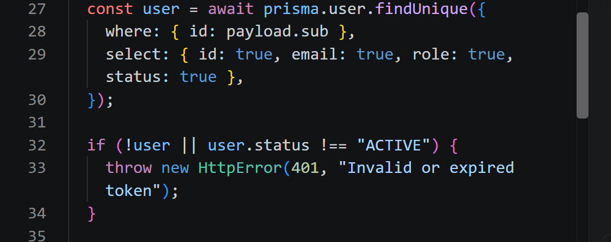
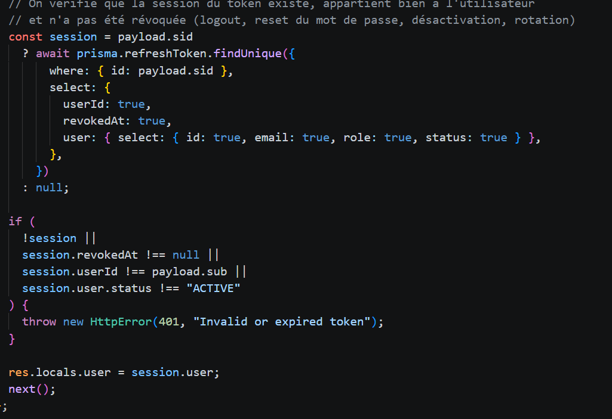
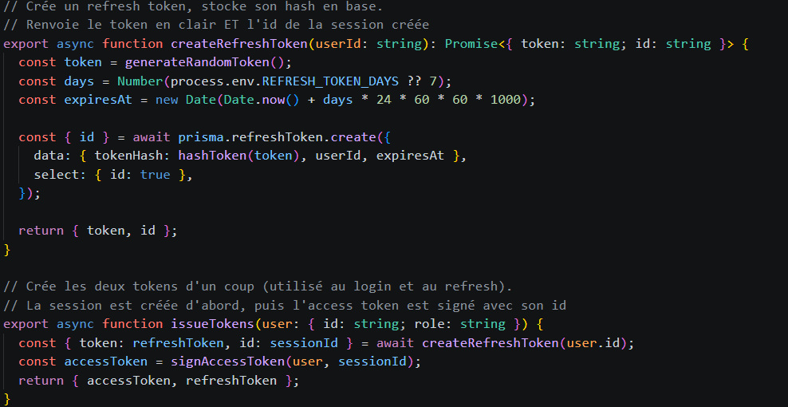

# NOM : Access token toujours valide après une déconnexion ou une réinitialisation du mot de passe

Après une déconnexion (logout) ou un changement de mot de passe, l'ancien access token (JWT) continue de donner accès à l'API pendant encore 15 minutes.

# DESCRIPTION

L'API utilise deux jetons :
 - un access token JWT, valable 15 minutes, envoyé à chaque requête
 - un refresh token, stocké en base (sous forme de hash), qui permet d'obtenir un nouvel access token

Lors d'une déconnexion ou d'une réinitialisation du mot de passe, l'API révoque uniquement les refresh tokens en base.

Cependant, l'access token n'est jamais invalidé. Le middleware authenticate vérifie seulement :
 - que la signature du JWT est valide et qu'il n'est pas expiré
 - que le compte existe et a le statut ACTIVE

Il ne vérifie pas si la session liée au token a été fermée. Un access token volé reste donc utilisable jusqu'à son expiration, même si l'utilisateur s'est déconnecté ou a changé son mot de passe pour se protéger.

# LOCALISATION

La vulnérabilité se trouve dans les fichiers :
 - src/middlewares/auth.ts:20       : seules la signature et l'expiration du JWT sont vérifiées (verifyAccessToken)
 - src/middlewares/auth.ts:27-34    : seul le statut du compte est vérifié, pas la session
 - src/lib/tokens.ts:25             : durée de vie de l'access token (15 minutes par défaut)
 - src/services/auth.service.ts:90-95 : logoutSession révoque uniquement le refresh token
 - src/services/auth.service.ts:191 : resetPassword révoque uniquement les refresh tokens

Les routes touchées sont :
 POST /auth/logout
 POST /auth/reset-password
 toutes les routes protégées par authenticate (GET /auth/me, /tickets, /users...)

# CRITERE : Moyenne

Justification :
 - L'attaquant doit d'abord avoir volé un access token (poste partagé, malware, fuite dans des logs, réseau non chiffré...).
 - La fenêtre d'exploitation est limitée à 15 minutes après la déconnexion ou le reset.
 - Mais c'est justement le moment où la victime réagit pour se protéger (se déconnecter, changer son mot de passe), et cette réaction n'a aucun effet immédiat.

# SCENARIO d'EXPLOITATION

1. La victime se connecte via POST /auth/login et reçoit un access token et un refresh token.

2. L'attaquant récupère l'access token de la victime (par exemple sur un ordinateur partagé, via un malware ou dans des logs).

3. La victime remarque une activité suspecte, ou quitte simplement l'ordinateur, et se déconnecte via POST /auth/logout. Elle peut aussi réinitialiser son mot de passe via POST /auth/reset-password.

4. L'API révoque les refresh tokens en base et répond 204 (ou 200 pour le reset). La victime pense être protégée.

5. L'attaquant continue d'utiliser l'ancien access token sur les routes protégées : il consulte le profil (GET /auth/me), lit les tickets, en crée au nom de la victime, change leur statut... Si la victime est SUPER_ADMIN, il peut aussi créer des utilisateurs ou des administrateurs.

6. L'accès ne s'arrête qu'à l'expiration naturelle du JWT, jusqu'à 15 minutes plus tard.

# PREUVE d'EXPLOITATION

Nous allons prouver l'existence de la vulnérabilité en réutilisant un access token après une déconnexion.

 Compte utilisé : aminataingreen@gmail.com
 Route testée : GET /auth/me (protégée par authenticate)

Script PowerShell utilisé: ./Aminata-Koante/test-logout.ps1

Résultats obtenus avant correction : 

À l'étape 4, l'utilisateur est déconnecté mais l'API accepte toujours son ancien access token : la déconnexion n'a aucun effet immédiat.

# IMPACT

Utilisateurs : la déconnexion et le changement de mot de passe ne les protègent pas immédiatement. Un attaquant peut agir en leur nom (lire leurs tickets, en créer, en modifier le statut) alors qu'ils pensent avoir sécurisé leur compte. Les actions de l'attaquant leur sont imputées dans l'historique (AuditLog).

Entreprise : si le compte compromis est un SUPER_ADMIN, l'attaquant peut, dans ces 15 minutes, inviter un nouvel administrateur et conserver un accès permanent à la plateforme. Perte de crédibilité et de confiance dans le système d'authentification.

Données : les tickets et les informations des utilisateurs restent consultables et modifiables par l'attaquant pendant toute la durée de validité du token.

# CORRECTION

Principe : lier chaque access token à sa session, c'est-à-dire à la ligne RefreshToken en base. Le JWT contient l'identifiant de la session (sid). À chaque requête, authenticate vérifie que cette session n'a pas été révoquée.

Une seule correction couvre ainsi tous les cas : déconnexion, reset du mot de passe, désactivation du compte et rotation des refresh tokens. Aucune modification du schéma Prisma n'est nécessaire.

## Avant

    

## Après

    

Cette correction garantit qu'un access token est refusé dès que sa session est fermée, sans attendre son expiration.

Adaptations nécessaires dans les tests :
 - tests/helpers/testContext.ts:109 : remplacer signAccessToken(user) par issueTokens(user), car un access token doit maintenant être lié à une session existante.
 - tests/auth.test.ts:185 et :193 : ces tests fabriquent des JWT à la main (faux secret, token expiré). Ils restent valides, car ces tokens sont refusés dès la vérification de la signature.

Effet secondaire à connaître : lors d'un refresh (POST /auth/refresh), l'ancienne session est révoquée, donc l'ancien access token devient invalide immédiatement. C'est le comportement attendu : le client doit utiliser le nouvel access token reçu.

# RETEST

On relance le même script test-logout.ps1 après la correction (en redémarrant l'API).

Résultat attendu après correction :

Finalement, avec la correction du code, l'ancien access token est refusé (401 "Invalid or expired token") dès la déconnexion. La déconnexion et la réinitialisation du mot de passe ferment désormais réellement la session : la vulnérabilité est corrigée.